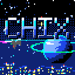
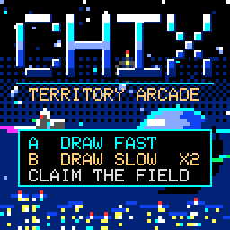

# CHix

An original arcade game for [CHGame](https://github.com/bateske/CHGame): draw lines out into the open field, close
them back on a border and claim the ground behind them, while a spinning enemy and its sparks hunt for your open
line. Forty-five stages, ten rainy cityscapes, ten power-ups and a psytrance soundtrack on a small FM synth. It is in the
spirit of the territory-claiming arcade classics; every line of code, picture, sprite and tune in this
repository is original.

## Controls

| Control | Action |
|---|---|
| D-pad | Move along the border; steer a line you are drawing |
| A + d-pad | Draw a fast line (blue, 10 points a cell) |
| B + d-pad | Draw a slow line (orange, 20 points a cell) |
| START | Pause menu: resume, save game, return to title |
| START (hold 3 s) | Back to the CHGame menu |

## Rules

- Walk the border. Push into the open field with A or B to draw a line; reach any border to close it and claim
  the side without the main enemy.
- Claim the stage's share of the field (70% at stage 1, 2 more every stage, then 85% from stage 9 on) to clear it. Bigger claims score more,
  and a slow line is worth double. Claim again within four seconds and the score multiplies, up to x5.
- The enemy kills you if it touches your open line. A spark kills you if it touches you. From stage 4 a fuse
  burns down your line if you stop drawing for a moment.
- Three lives, and an extra one at every 10,000 points. A spark caught inside a claimed area explodes for 1,000.
- Clear stage 45 to win.

## Enemies

Stages 1 to 25: eight main enemies come round in turn: the roaming line, cube drone, octa core, pyra scout, prism hunter,
hex warden, icosa mind and tesseract. The core gets faster, the sparks speed up from stage 6, and a third spark joins
at stage 8.

Stages 26 to 45 are harder. Five new solids (star core, ring warden, cubocta, spire lord, cross gate) come first. From
stage 31 the enemy is a twin pair, one solid at each end of the line, spinning out of step: either can kill you, and a
twin caught inside ground you claim blows up for 3,000 and returns beside the other. A fourth spark joins at stage 30,
the sparks run faster from stage 36, and the last stages end on twin tesseracts.

## Power-ups

Pick-ups appear in the field and are collected by drawing onto them or closing round them. New ones unlock as you go.

| Power-up | Effect | From stage |
|---|---|---|
| Time freeze | The enemy stops and cannot hurt your line | 1 |
| Speed up | Two steps a frame; slow lines at full speed | 1 |
| Lasers | Beams along your row and column send sparks away | 1 |
| Shield | Nothing can hurt you | 1 |
| Slow | Enemies move at half speed | 1 |
| Bonus | +2,500 points | 1 |
| Score x2 | Double points | 5 |
| Ghost trail | The enemy cannot hurt your line | 9 |
| Bomb | Destroys every spark for 1,500 points | 13 |
| Extra life | One more life | 17 |

## Saving

The game saves at the start of each stage and from the pause menu (SAVE GAME). The title offers CONTINUE or NEW GAME
when a save exists. A continued game restarts its stage with the saved lives and score. The best score is kept too.

## Building

You need the CHGame board package and a CHGame board. From this folder:

    ./cl build      # build
    ./cl upload     # flash it to the board

`dist/CHix.CHG` is the packed game for the CHGame SD menu.

## Developer notes

- `CHix/CHix.ino` is the whole game: one sketch, integer maths, drawing straight into CHGfx's framebuffer.
- The playfield is a 60x56 grid of 2x2-pixel cells. A claimed cell shows 2x2 pixels of its stage's picture: a rainy
  cyberpunk skyline drawn per pixel at the panel's full 120x112 (`sceneTone`), with the animation (rain, flying
  cars) drawn over it. Nothing is stored: ten scene recipes in a small table. Border flags are cached in the grid,
  so a frame does no neighbour scans.
- The title picture, sprites, boss cores and songs are generated by the scripts in `tools/` (`gen_art.py`,
  `make_sprites.py`, `make_bosses.py`, `make_shapes.py`, `make_boxart.py`, `make_music.py`) into the headers in `CHix/`. The
  generated headers are checked in, so building needs none of them.
- The sound is a small software synth (`CHix/Synth.cpp`): a timer interrupt mixes three 2-operator FM voices (a bell
  lead, a pluck bass and a glassy arpeggio) and a drum voice into the piezo as 8 kHz PWM, and the game's effects play
  on top as a square voice. The nine songs (downtempo dub for the title; stages 1 to 25 cycle aurora, dark psy, goa, full-on and forest, calmest to most frantic; stages 26 to 45 cycle progressive, nebula and hi-tech; the title, aurora and nebula are ambient at 80 BPM) are 16-bar step sequences (`tools/make_music.py`, 1 KB each), each with its own FM sound.
- Measured on the board (`./cl run --device CHix/tools/scripts/perf.txt out/perf`, `-D CHIX_START_LEVEL=n` for a
  later stage): about 16 ms a frame, 27 ms at worst, for a steady 30 fps (stage 45, with twin tesseracts and four sparks: 18 ms, 26 ms at worst). `GFX_CHUNK_ROWS=1` (in
  `CHix/tools/game.py`) gives back about 500 B of RAM.
- Budgets: the image must stay at or below 50,432 B so both save pages survive, and static RAM is nearly full.

## Credits and licence

Game, art, music and code: Jadflat, MIT (see `LICENSE`).

The 8x8 sprites and 12x12 boss cores were drawn as text grids in the CHGame house palette and rendered to PNG with the
author's own CHGame-tuned "pixel-art-gen" Claude skill (a Pixel Art Generator skill set up with the CHGame palette and pixel-art
rules); they were checked with CHGame's `artkit.craft` against its pixel-art
rules (`docs/pixel-art.md` in CHGame). The title picture and the stage scenes are generated by this repository's own code.

The sound output (an 8-bit PWM written by a timer interrupt) follows the design proven by
[chgame-soundtracks](https://github.com/ESPboy-edu/ESPboy_CHCore/tree/main/LIBS/chgame-soundtracks) in ESPboy-edu's ESPboy_CHCore (BSD 3-Clause;
see `THIRD-PARTY.md`), and CHeleste's software mixer showed it was practical (no code taken). The synth, songs and sequencer on top are CHix's own.

Built on CHGame, Copyright 2026 Kevin Bates (bateske), Apache-2.0: the framework is vendored in `chgame/`
(see `chgame/NOTICE` and `chgame/LICENSE`).
